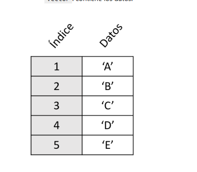
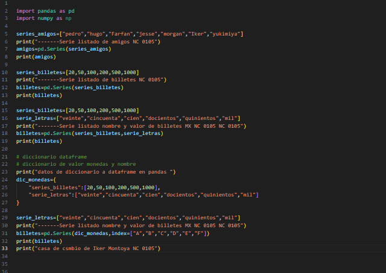
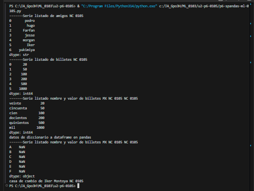

Una serie es, en su sentido más general, un conjunto de cosas o eventos relacionados que suceden uno tras otro en un orden determinado.
Como es una palabra que se usa en muchas disciplinas diferentes, su significado exacto cambia según el contexto:

1. En entretenimiento y televisión

Es una obra audiovisual narrativa que se transmite en entregas periódicas (episodios) y que mantiene una continuidad temática o argumental. Se organiza en temporadas y suele contar con un equipo de guionistas liderado por un showrunner.

2. En matemáticas y lógica

• Series matemáticas (Cálculo): Es la suma de los infinitos términos de una sucesión numérica. Si la suma total se acerca a un número fijo se dice que converge; si va hacia el infinito, diverge.
• Series lógicas o numéricas (Básicas): Es una secuencia de números u objetos ordenados que siguen un patrón o regla fija (por ejemplo: 2, 4, 6, 8... donde la regla es sumar 2).

3. En el deporte y gimnasio

En el entrenamiento físico, una serie es un grupo de repeticiones de un mismo ejercicio que se realizan de forma continua antes de tomar un descanso. Por ejemplo, hacer "3 series de 10 flexiones" significa hacer 10 flexiones, descansar, y repetir ese ciclo dos veces más.

4. En la industria y comercio

• Producción en serie: Es la fabricación de una gran cantidad de productos idénticos utilizando moldes o líneas de montaje (producción masiva).
• Billetes o estampillas: Conjunto de valores impresos que comparten el mismo año, diseño o numeración consecutiva.

## el codigo 

## resultados 
